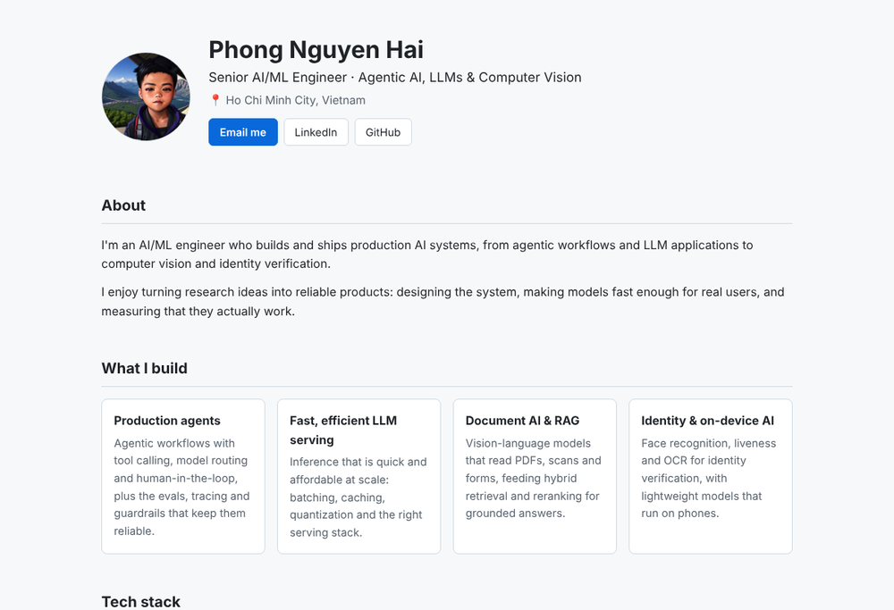

# jcphong.github.io

Personal site of **Phong Nguyen Hai**, AI/ML engineer working on agentic AI, LLM serving, document AI and computer vision.

**Live:** https://jcphong.github.io



## What's here

| File | Purpose |
| --- | --- |
| `index.html` | The whole site: one static page, no build step |
| `assets/` | Avatar, link-preview image (`og.jpg`) and screenshot |
| `404.html` | Page shown for missing URLs |
| `robots.txt`, `sitemap.xml` | Search-engine hints |

## Adding a project

Projects appear automatically from public, non-fork repos. To feature one with a status badge or demo
link, add an entry to the `PROJECTS` array near the bottom of `index.html`:

```js
const PROJECTS = [
  {
    name: "vn-embedding-bench",
    url: "https://github.com/jcphong/vn-embedding-bench",
    description: "Vietnamese embedding & reranker leaderboard",
    tags: ["RAG", "Vietnamese"],
    status: "In progress",
    links: { "Demo": "https://huggingface.co/spaces/..." },
  },
];
```

The Projects section stays hidden until there is at least one project to show.

## Contact

[jcphong@gmail.com](mailto:jcphong@gmail.com) · [LinkedIn](https://www.linkedin.com/in/phong-nguyen-hai-53326816b/)
